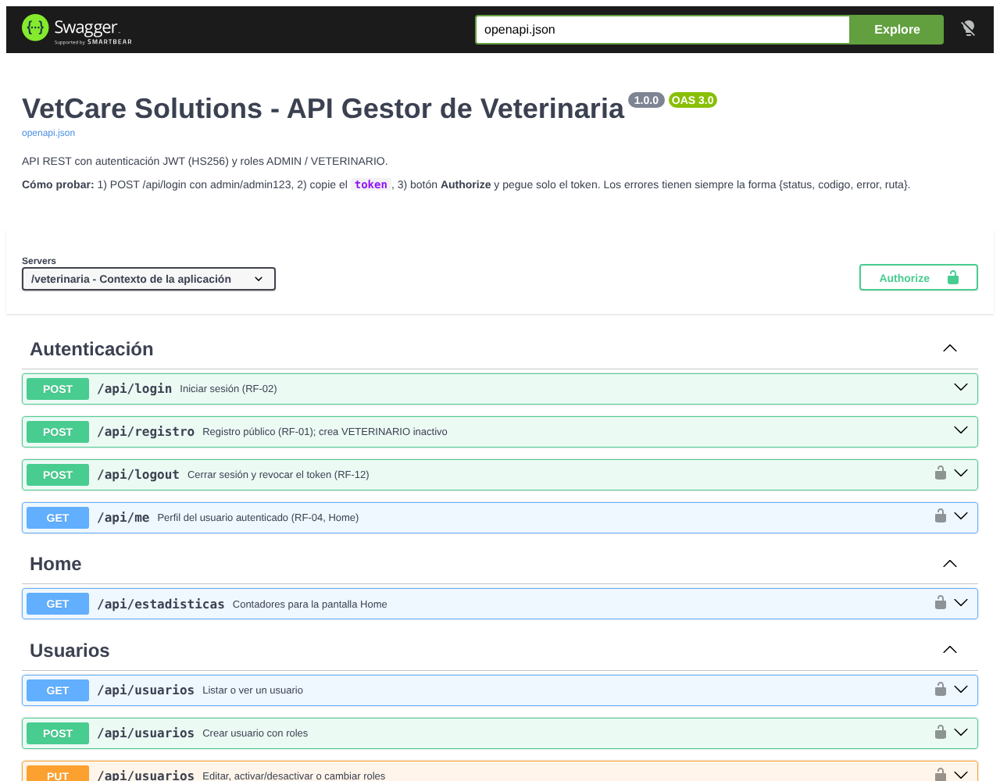
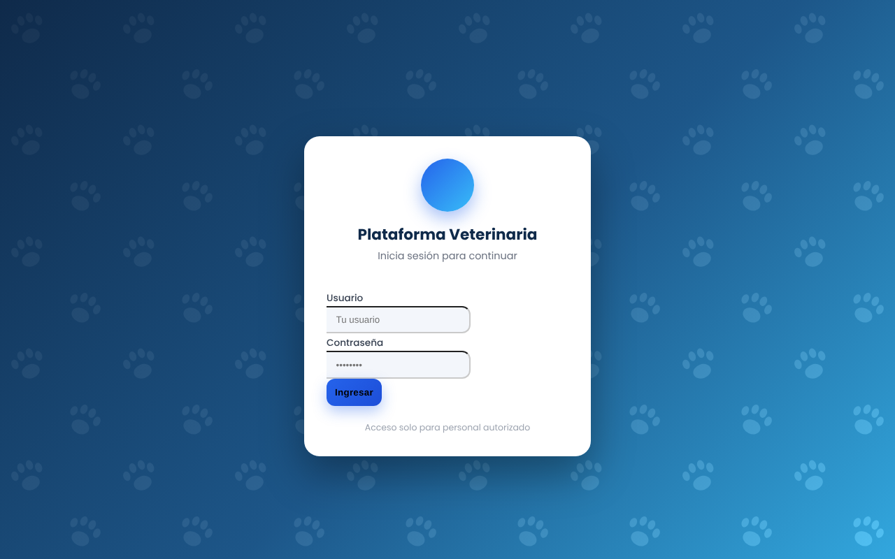
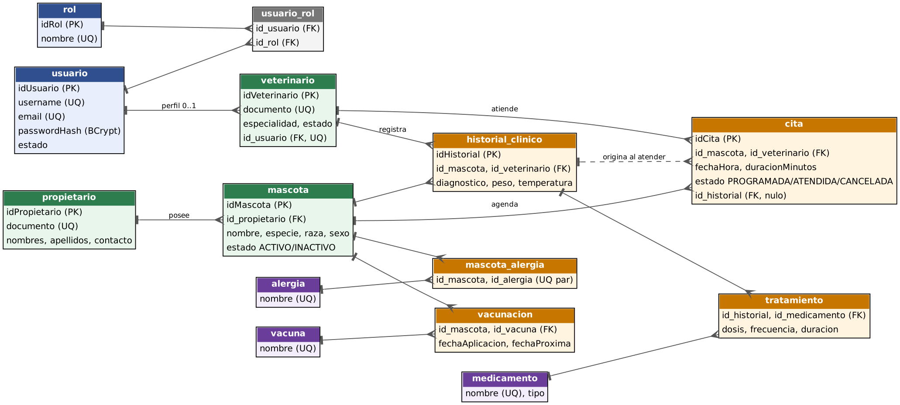

# 🐾 VetCare – API REST para gestión de clínicas veterinarias

Backend de una clínica veterinaria: propietarios, mascotas, veterinarios, citas, historia clínica, tratamientos, vacunas y alergias. Lo usan un panel web y una app Android, y cada rol tiene sus propios permisos.

Proyecto final de la materia de Backend – Tecnología en Desarrollo de Aplicaciones Web y Móviles, Fundación Universitaria Compensar.

📄 **Documentación de la API (Swagger):** https://danieladiaz1510.github.io/VetCare-Backend/



## 🛠️ Tecnologías

| Capa | Tecnología |
|---|---|
| Lenguaje | Java 17 |
| Servidor | Jakarta EE 10 (Servlets 6) sobre Apache Tomcat 10 |
| Persistencia | JPA + Hibernate 6.4, MySQL 8 |
| Seguridad | JWT HS256 implementado a mano, contraseñas con BCrypt, roles y permisos |
| Reportes | Exportación a Excel (Apache POI) y PDF (iText 7) |
| Pruebas | JUnit 5 (unitarias) y script de integración con curl |
| Documentación | OpenAPI 3 / Swagger UI |
| Build | Maven (empaquetado WAR) |

## ✨ Funcionalidades

- **Autenticación con JWT:** inicio de sesión, registro, cierre de sesión con revocación del token y bloqueo tras demasiados intentos fallidos.
- **Dos roles con permisos distintos:**
  - **ADMIN** puede hacer todo.
  - **VETERINARIO** solo gestiona sus propias citas e historias clínicas.
  - Lo que no está permitido de forma explícita se niega.
- **CRUD completo** de propietarios, mascotas, veterinarios, usuarios, vacunas, medicamentos y alergias.
- **Citas:** agendar, cancelar y atender. Al atender una cita se genera su historia clínica.
- **Historia clínica** con tratamientos, vacunación (con fecha de la próxima dosis) y alergias por mascota.
- **Auditoría** de las acciones de los usuarios, **respaldo** de la base de datos y **estadísticas** para la pantalla de inicio.
- **Exportación** de mascotas, propietarios y veterinarios a Excel y PDF.
- **Errores uniformes:** todas las respuestas de error tienen la forma `{status, codigo, error, ruta}`.
- **Panel web** en HTML, CSS y JavaScript que consume la API.



## 🏗️ Arquitectura por capas

```
Petición HTTP
   │
   ▼
filter      → ApiSecurityFilter: valida el token, el estado de la cuenta y los permisos
controler   → recibe la petición y responde en JSON
service     → reglas de negocio y transacciones
dao         → consultas con JPA / JPQL
model       → entidades (tablas)
   │
   ▼
MySQL
```

Paquetes de apoyo:
- `DTO`: los objetos que viajan por la red.
- `security`: JWT, matriz de permisos y tokens revocados.
- `exception`: los errores de negocio.
- `util`: configuración, validación y manejo central de errores.

### Modelo de datos



## 🚀 Cómo ejecutarlo

**Requisitos:** Java 17, Maven, MySQL 8 y Apache Tomcat 10.

1. **Crea la base de datos:**
   ```bash
   mysql -u root -p < database/schema.sql
   mysql -u root -p veterinaria < database/seed.sql   # datos de ejemplo
   ```
2. **Define las variables de entorno.** Ningún secreto queda escrito en el código:

   | Variable | Para qué sirve |
   |---|---|
   | `JWT_SECRET` | Firma los tokens. Mínimo 32 caracteres. |
   | `DB_URL`, `DB_USER`, `DB_PASSWORD` | Conexión a MySQL. |
   | `JWT_EXPIRA_MINUTOS` | Duración del token. Opcional; por defecto 60. |

3. **Compila y despliega:**
   ```bash
   cd backend/veterinaria
   mvn clean package
   ```
   Despliega `target/veterinaria.war` en Tomcat 10.
4. **Abre la aplicación:**
   - Panel web: http://localhost:8080/veterinaria/
   - Swagger: http://localhost:8080/veterinaria/swagger/

**Cuentas de demostración:** `admin / admin123` y `veterinario / vet12345`. Son solo para pruebas locales.

## 🧪 Pruebas

```bash
# Unitarias: JWT, matriz de permisos y validaciones
cd backend/veterinaria && mvn test

# Integración: con la API corriendo
bash documentacion/Pruebas/pruebas_api.sh http://localhost:8080/veterinaria
```

## 📁 Estructura

```
backend/veterinaria/   Código Java, panel web y Swagger (Maven)
database/              schema.sql (estructura) y seed.sql (datos de ejemplo)
documentacion/         Resumen técnico, diagramas y pruebas de integración
docs/                  Swagger publicado en GitHub Pages
```

---

👩‍💻 **Daniela Díaz Falla** · [GitHub](https://github.com/DanielaDiaz1510) · [LinkedIn](https://www.linkedin.com/in/daniela-diaz-517538385/) · [Portafolio](https://danieladiaz1510.github.io/Ejemplo_Portafolio/)
