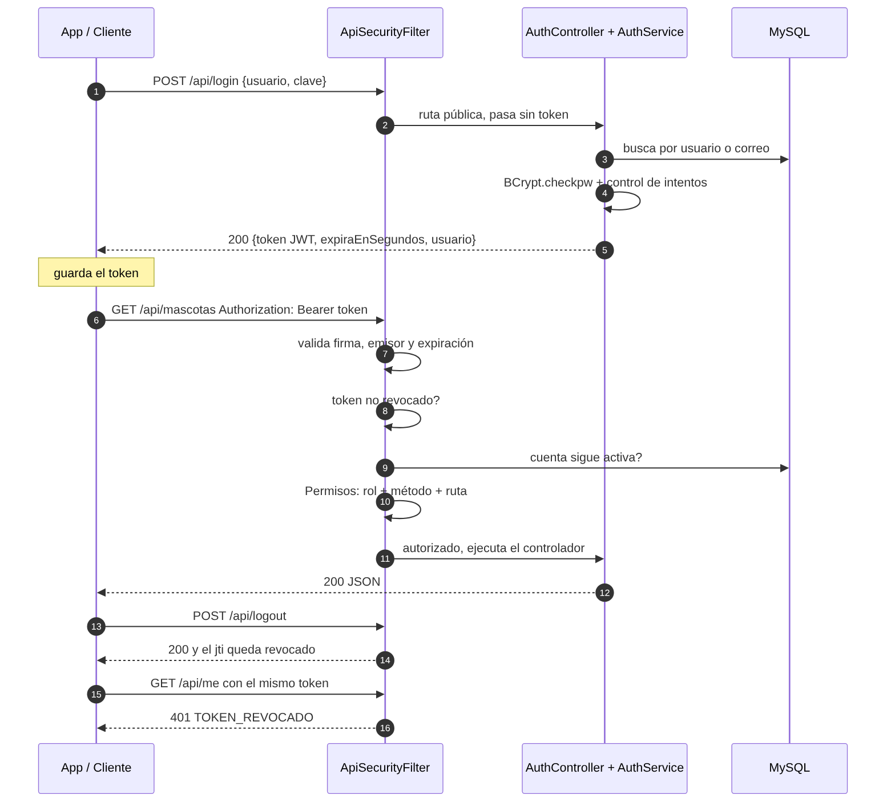
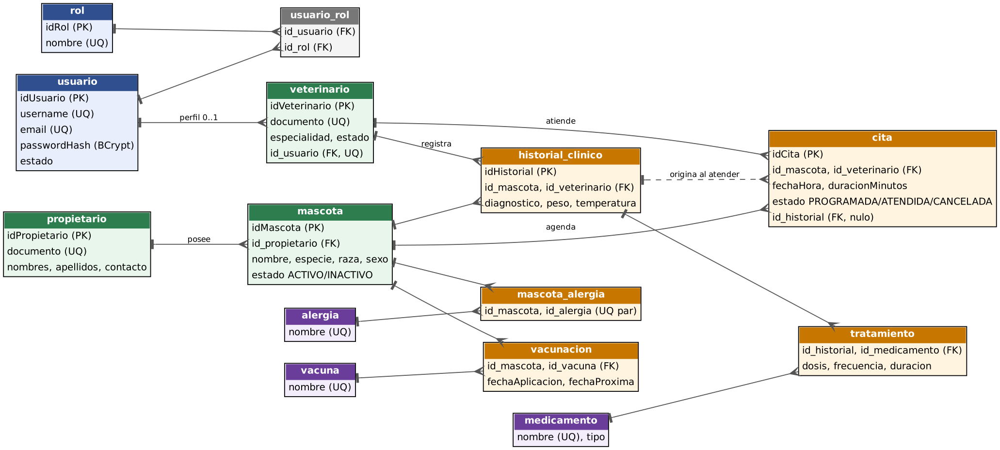

# 1. ¿Qué es este backend y qué resuelve?

Es una **API REST** que guarda y entrega los datos de una clínica veterinaria: propietarios, mascotas, veterinarios, citas, historia clínica, tratamientos, vacunas y alergias. La app Android no toca la base de datos: **solo habla con esta API por HTTP, enviando y recibiendo JSON**. La API decide quién puede hacer qué (seguridad) y qué datos son válidos (reglas de negocio).

Dos roles:

| Rol | Qué puede hacer |
|---|---|
| **ADMIN** | Todo: usuarios, veterinarios, borrados/desactivaciones, auditoría, respaldo de BD. |
| **VETERINARIO** | Consultar, crear y editar propietarios, mascotas, citas, historias, tratamientos y vacunas. Solo gestiona **sus propias** citas e historiales. No administra usuarios, no borra, no ve auditoría. |

Cuentas de demostración (cargadas por `seed.sql`): `admin / admin123`, `veterinario / vet12345`, `dra.rojas / vet12345`.

# 2. Tecnologías y por qué se usan

| Pieza | Para qué sirve |
|---|---|
| **Java 17** | Lenguaje del backend. |
| **Jakarta Servlets 6 / Tomcat 10** | Reciben las peticiones HTTP. Cada "Controller" es un servlet que atiende una ruta (`/api/mascotas`). |
| **JPA + Hibernate 6.4** | Traducen entre objetos Java (entidades) y tablas SQL, sin escribir SQL a mano en la mayoría de casos. |
| **MySQL** | Base de datos relacional con llaves primarias, foráneas y restricciones (RNF-09). |
| **Jackson** | Convierte objetos Java ⇄ JSON. |
| **jBCrypt** | Guarda contraseñas como hash irreversible. |
| **JWT HS256 (implementado a mano)** | Token firmado que prueba quién es el usuario sin guardar sesión en el servidor. |
| **Apache POI / iText** | Exportación a Excel y PDF. |
| **JUnit 5** | Pruebas unitarias. |

# 3. Arquitectura por capas (RNF-05)

Una petición atraviesa siempre las mismas capas, cada una con una sola responsabilidad:

| Capa (paquete) | Responsabilidad | Ejemplo |
|---|---|---|
| `filter` | **Puerta de entrada**: autentica y autoriza antes de llegar a cualquier controlador. | `ApiSecurityFilter` |
| `controler` | Lee la petición HTTP, llama al servicio y escribe la respuesta JSON. No contiene reglas. | `CitaController` |
| `service` | **Reglas de negocio** y validaciones. Abre las transacciones. | `CitaService` |
| `dao` | Consultas a la base de datos (JPA/JPQL). | `CitaDAO` |
| `model.entity` | Clases que representan las tablas. | `Cita`, `Mascota` |
| `DTO` | Objetos que viajan por la red (evitan exponer entidades completas). | `CitaDTO` |
| `security` | JWT, matriz de permisos, tokens revocados, usuario autenticado. | `JwtUtil`, `Permisos` |
| `exception` | Errores propios (validación, no encontrado, regla de negocio…). | `ReglaNegocioException` |
| `util` | Configuración, JSON, validador, manejo central de errores, transacciones, datos iniciales. | `ErrorApi`, `Tx` |

El proyecto tiene ~7.700 líneas Java: 24 controladores, 16 servicios, 14 DAO, 15 entidades, 16 DTO.

**Equivalencia con la estructura del PDF (Api / Application / Domain / Infrastructure):** `controler`+`filter` ≈ Api; `service`+`DTO` ≈ Application; `model.entity`+`exception` ≈ Domain; `dao`+`util`(JPA) ≈ Infrastructure. Es la misma separación con otros nombres.

# 4. Seguridad (RNF-03, RF-02, RF-03, RF-12)

## 4.1 Cómo se autentica una petición

{width=95%}

El filtro `ApiSecurityFilter` protege todo `/api/*` y aplica estos pasos **en orden**; si uno falla, responde de inmediato y no llega al controlador:

1. ¿Ruta pública? (`POST /api/login`, `POST /api/registro`) → pasa.
2. ¿Trae `Authorization: Bearer <token>`? Si no → **401**.
3. ¿Firma, emisor y expiración válidos? Si no → **401**.
4. ¿El token fue revocado por logout? → **401 TOKEN_REVOCADO**.
5. ¿La cuenta sigue activa en la BD? Si se desactivó → **401** (efecto inmediato).
6. ¿El rol permite ese método y esa ruta? Si no → **403**.
7. Se ejecuta el controlador.

**401 = no sé quién eres. 403 = sé quién eres pero no tienes permiso.**

## 4.2 El token JWT

Tiene tres partes en Base64 separadas por puntos: *cabecera.contenido.firma*. El contenido (claims) incluye: `iss` (emisor `veterinaria-api`), `sub` (usuario), `uid`, `nombre`, `roles`, `jti` (identificador único del token), `iat` (emitido) y `exp` (vence). La **firma HMAC-SHA256** se calcula con un secreto que solo conoce el servidor; si alguien modifica el contenido (por ejemplo, cambia su rol a ADMIN) la firma deja de coincidir y se rechaza.

Se rechazan: `alg:none`, firma alterada, firma con otro secreto, emisor ajeno y tokens sin `exp`. La firma se compara en **tiempo constante** para evitar ataques de temporización. El secreto viene de la variable `JWT_SECRET` (mínimo 32 caracteres) y la vigencia de `JWT_EXPIRA_MINUTOS` (60 por defecto). Si `JWT_SECRET` no está definida, el servidor usa un secreto de *desarrollo* y lo avisa en el log; en una entrega o uso real debe definirse siempre.

## 4.3 Matriz de permisos (denegar por defecto)

La clase `Permisos` lista lo permitido; **lo que no está listado se niega**. Así, si mañana se agrega una ruta y se olvida declararla, queda bloqueada en lugar de abierta.

| Recurso | ADMIN | VETERINARIO |
|---|:-:|:-:|
| `/api/usuarios`, `/api/roles`, `/api/auditoria`, `/api/backup` | ✔ | ✘ 403 |
| `/api/veterinarios` (GET) | ✔ | ✔ |
| `/api/veterinarios` (POST/PUT/DELETE) | ✔ | ✘ 403 |
| Cualquier `DELETE` | ✔ | ✘ 403 |
| Resto de GET / POST / PUT (propietarios, mascotas, citas, historiales…) | ✔ | ✔ (solo lo propio en citas/historiales) |
| `/api/me`, `/api/logout` | ✔ | ✔ |

## 4.4 Login, registro y logout

* **Login** (`POST /api/login`): acepta usuario **o** correo. Ante usuario inexistente o clave errónea devuelve **el mismo mensaje**, y hace un BCrypt de relleno para que el tiempo de respuesta tampoco delate si la cuenta existe. Tras **5 intentos fallidos** bloquea 5 minutos (**429**). Variables: `LOGIN_MAX_INTENTOS`, `LOGIN_BLOQUEO_SEGUNDOS`.
* **Registro** (`POST /api/registro`, RF-01): valida correo y usuario únicos y política de contraseña (mín. 8, letras y números). Crea un VETERINARIO **inactivo**; un ADMIN debe activarlo. Nunca se puede registrar un ADMIN por esta vía.
* **Logout** (`POST /api/logout`, RF-12): el `jti` del token queda en una lista de revocados; aunque alguien lo conserve, deja de servir. La app además borra el token local.

# 5. Base de datos (RNF-09)

{width=100%}

* 15 tablas creadas por `database/schema.sql` con PK, FK, `UNIQUE` y `CHECK`.
* **Únicos**: usuario, correo, documento de propietario y de veterinario, nombre de rol/vacuna/medicamento/alergia, par mascota–alergia.
* **Desactivar en vez de borrar**: una mascota o veterinario con historia clínica no se elimina; pasa a `INACTIVO` para conservar el historial. Un propietario solo se elimina si no tiene mascotas (si no, **409**).
* Hibernate usa `hbm2ddl.auto=update` por defecto (crea lo que falte); en producción se recomienda `DB_HBM2DDL=validate`. Se comprobó que `schema.sql` coincide exactamente con las entidades (`validate` pasa y falla si falta una columna).

# 6. Reglas de negocio de las citas

| Regla | Qué verifica | Error |
|---|---|---|
| R1 | La cita no puede estar en el pasado. | 400 |
| R2 | Mascota y veterinario deben estar ACTIVOS. | 409 |
| R3 | El veterinario no puede tener dos citas que se crucen. | 409 |
| R4 | La mascota no puede tener dos citas que se crucen. | 409 |
| R5 | Solo una cita PROGRAMADA se edita, cancela o atiende. | 409 |
| R6 | Solo se atiende el día de la cita o después. | 409 |
| R7 | Un VETERINARIO solo gestiona sus citas e historiales (ADMIN todo). | 403 |

Para que dos peticiones simultáneas no agenden el mismo horario se usa **bloqueo pesimista** sobre el veterinario dentro de la transacción. Al **atender** una cita se crea automáticamente el historial clínico y se enlaza con ella.

# 7. Catálogo de endpoints

La documentación interactiva está en **Swagger UI** (`documentacion/Swagger/index.html`, o `http://localhost:8080/veterinaria/swagger/` con la app corriendo) y el contrato en `openapi.json`.

| Método y ruta | Función | Rol |
|---|---|---|
| POST `/api/login` | Iniciar sesión, devuelve JWT | público |
| POST `/api/registro` | Registro (cuenta pendiente) | público |
| POST `/api/logout` | Cerrar sesión / revocar token | autenticado |
| GET `/api/me` | Perfil del usuario (Home, RF-04) | autenticado |
| GET `/api/estadisticas` | Contadores del Home | ambos |
| GET/POST/PUT `/api/usuarios`, GET `/api/roles` | Gestión de usuarios y roles | ADMIN |
| GET/POST/PUT/DELETE `/api/propietarios` | CRUD propietarios (`?q=`, `?documento=`, `?id=`) | ambos (DELETE ADMIN) |
| GET/POST/PUT/DELETE `/api/mascotas` | CRUD mascotas (`?q=`, `?especie=`, `?estado=`, `?idPropietario=`) | ambos (DELETE ADMIN) |
| GET/POST/PUT/DELETE `/api/veterinarios` | Veterinarios | GET ambos; resto ADMIN |
| GET/POST/PUT `/api/citas`, GET `/api/citas/{id}`, POST `/api/citas/{id}/cancelar`, POST `/api/citas/{id}/atender` | Agenda | ambos |
| GET/POST/PUT/DELETE `/api/historiales`, `/api/tratamientos` | Historia clínica | ambos (DELETE ADMIN) |
| GET/POST/PUT/DELETE `/api/vacunaciones`, `/api/mascota-alergias` | Carnet y antecedentes | ambos (DELETE ADMIN) |
| GET/POST/PUT/DELETE `/api/vacunas`, `/api/medicamentos`, `/api/alergias` | Catálogos | ambos (DELETE ADMIN) |
| GET `/api/export/{mascotas,propietarios,veterinarios}/{excel,pdf}` | Reportes | ambos |
| GET `/api/auditoria`, GET `/api/backup` | Auditoría y respaldo SQL | ADMIN |

**Búsqueda por dos criterios (RF-09):** mascotas por nombre + especie (+estado, propietario); propietarios por texto + documento; citas por estado, veterinario, mascota y fecha. **Detalle (RF-10):** `?id=` o `/api/citas/{id}`.

# 8. Formato único de errores (RNF-08)

Todo error, venga de donde venga, tiene la misma forma, lo que simplifica la app Android:

```json
{ "status": 409, "codigo": "REGLA_NEGOCIO",
  "error": "El veterinario ya tiene una cita que se cruza con ese horario",
  "ruta": "/veterinaria/api/citas" }
```

| Código HTTP | Cuándo |
|---|---|
| 400 | Datos inválidos o faltantes |
| 401 | Sin token, token inválido/vencido/revocado, credenciales erróneas |
| 403 | Rol sin permiso |
| 404 | Registro inexistente |
| 409 | Duplicado, regla de negocio o integridad referencial |
| 429 | Demasiados intentos de login |
| 500 | Error interno (el detalle técnico no se expone al cliente) |

Clase `ErrorApi`: recorre la cadena de causas de la excepción y clasifica por la primera que reconoce.

# 9. Cómo ejecutarlo

1. Crear la BD: `mysql -u root -p < database/schema.sql` y luego `mysql -u root -p veterinaria < database/seed.sql` (el seed es opcional; si la BD está vacía, la app crea sola los roles y las cuentas `admin` y `veterinario`).
2. Variables de entorno:

| Variable | Significado | Por defecto |
|---|---|---|
| `JWT_SECRET` | Secreto de firma (≥ 32 caracteres) | secreto de desarrollo + aviso (definirla siempre) |
| `JWT_EXPIRA_MINUTOS` | Vigencia del token | 60 |
| `DB_URL`, `DB_USER`, `DB_PASSWORD` | Conexión MySQL | localhost / root / vacío |
| `DB_HBM2DDL` | `none`, `validate`, `update` | `update` |
| `BACKUP_MYSQLDUMP` | Ruta de `mysqldump` | ruta XAMPP de Windows |
| `LOGIN_MAX_INTENTOS`, `LOGIN_BLOQUEO_SEGUNDOS` | Anti fuerza bruta | 5 / 300 |

3. Compilar `mvn clean package` y desplegar `veterinaria.war` en Tomcat 10 (contexto `/veterinaria`).
4. Abrir `http://localhost:8080/veterinaria/` (panel web) o `/swagger/` (documentación).

Desde el **emulador de Android** el servidor de tu PC se ve como `http://10.0.2.2:8080/veterinaria/api/`.

# 10. Cómo se probó (resultados reales)

| Prueba | Resultado |
|---|---|
| 109 pruebas unitarias JUnit (JWT, permisos, validador) | **109 pasan, 0 fallan** |
| *Prueba de mutación*: se introdujeron defectos a propósito para confirmar que las pruebas los detectan | 14 pruebas fallaron al romper el código, como debía |
| 138 pruebas de integración (`documentacion/Pruebas/pruebas_api.sh`) contra Tomcat + Hibernate + MariaDB reales: login, 401/403, validaciones, unicidad, reglas de citas, historial, vacunas, desactivación, logout/revocación, bloqueo por fuerza bruta, exportación, auditoría | **138 pasan, 0 fallan** |
| Base creada solo con `schema.sql` + `seed.sql`, Hibernate en `validate`, login con las 3 cuentas | Correcto |
| Swagger UI en Chromium: login → Authorize → llamada protegida | 200 |
| Panel web en Chromium: login, descarga Excel y respaldo con token, crear usuario con rol, logout, VETERINARIO sin menús admin y 403 | Correcto |

Las pruebas de integración se ejecutaron con MariaDB 10.11 (compatible con MySQL).

# 11. Cobertura de requisitos del PDF

| Requisito | Cómo lo cubre el backend |
|---|---|
| RF-01 Registro y correo único | `POST /api/registro`, `UNIQUE` en `email` y `username` |
| RF-02 Login con JWT | `POST /api/login` |
| RF-03 Dos roles | ADMIN y VETERINARIO, matriz `Permisos` |
| RF-04 Home con perfil | `GET /api/me`, `GET /api/estadisticas` |
| RF-05 Crear | POST en todas las entidades |
| RF-06 Listar | GET en todas las entidades |
| RF-07 Editar | PUT en todas las entidades |
| RF-08 Eliminar o desactivar | DELETE (ADMIN); mascotas/veterinarios se desactivan |
| RF-09 Buscar y filtrar por 2 criterios | Filtros descritos en la sección 7 |
| RF-10 Detalle | `?id=` y `/api/citas/{id}` |
| RF-11 Preferencias de interfaz | **Lado Android** (almacenamiento local); no requiere backend |
| RF-12 Cerrar sesión | `POST /api/logout` + borrado del token en la app |
| RNF-03 Seguridad | JWT, roles, validación en servidor |
| RNF-05 Mantenibilidad | Arquitectura por capas |
| RNF-07 Validaciones cliente y servidor | `Validador` en servidor (cliente: app) |
| RNF-08 Errores controlados | Formato único de error |
| RNF-09 Integridad referencial | `schema.sql` con FK y `UNIQUE` |
| RNF-10 Git, documentación, pruebas | Pruebas y scripts incluidos; Git lo crea el equipo |

# 12. Preguntas probables del profesor y cómo responderlas

**¿Por qué JWT y no sesiones?** El servidor no guarda estado: el token lleva la identidad firmada. Es lo que usa una app móvil, que no maneja cookies de navegador.

**¿Qué pasa si alguien modifica el token?** La firma HMAC no coincidiría y el filtro responde 401. Sin el secreto no puede generar una firma válida.

**¿Dónde se guarda la contraseña?** Solo su hash BCrypt (con sal incluida). Nunca en texto plano ni en el token.

**¿Diferencia entre 401 y 403?** 401: no autenticado. 403: autenticado sin permiso para ese recurso.

**¿Cómo evitan que un veterinario vea o edite lo de otro?** La regla R7 en los servicios comprueba que la cita/historial pertenezca al veterinario del token; el ADMIN no tiene esa restricción.

**¿Por qué no se borran las mascotas?** Porque tienen historia clínica, que es información médica que debe conservarse; se desactivan.

**¿Cómo evitan dos citas al mismo tiempo?** Validan cruces (R3/R4) y bloquean al veterinario dentro de la transacción para que dos peticiones simultáneas no pasen a la vez.

**¿Qué hace el logout si el JWT no tiene estado?** Guarda el `jti` en una lista de revocados que el filtro consulta.

**¿Protección contra inyección SQL?** Todas las consultas usan parámetros (JPA); además `Validador` rechaza caracteres sospechosos en campos como el documento.

**¿Por qué Java si el PDF habla de C#/.NET?** Ver sección 13.

# 13. Limitaciones y puntos por confirmar (con honestidad)

1. **Tecnología del backend.** El PDF del profesor menciona C# .NET 8+. Se acordó usar este backend Java, pero **conviene confirmarlo por escrito con el profesor** antes de la entrega.
2. **Maven.** El entorno donde se desarrolló no tenía acceso a Maven Central, así que el `pom.xml` (con JUnit 5 y Surefire agregados) está bien formado pero **no se ejecutó `mvn package` aquí**. Se compiló con `javac --release 17` y se desplegó con las mismas librerías; en su equipo debe correr `mvn clean package` y avisar si hay algún ajuste.
3. **Tokens revocados en memoria**: se pierden si Tomcat se reinicia (un token ya cerrado volvería a servir hasta que expire). Mejora: guardarlos en BD.
4. **Cambios de rol** se reflejan al volver a iniciar sesión (los roles viajan en el token); la desactivación de una cuenta sí es inmediata.
5. **Registro público** deja la cuenta pendiente de aprobación por un ADMIN (decisión de seguridad).
6. **Respaldo** requiere `mysqldump` instalado y configurar `BACKUP_MYSQLDUMP`.
7. **HTTP sin TLS** en desarrollo (la app usa `usesCleartextTraffic`); en producción debe ir con HTTPS.
8. **Entregables aún pendientes** según el PDF: la **app Android**, los 8 diagramas UML (aquí solo están ER y secuencia de autenticación), wireframes, manual de usuario y el repositorio Git.
